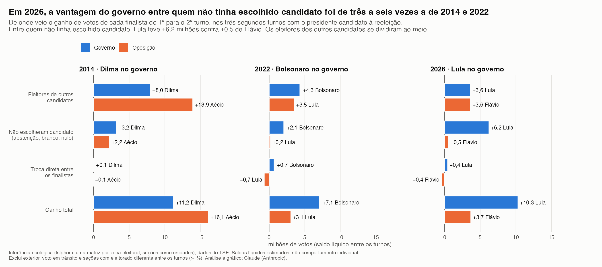

# Transição de votos entre o 1º e o 2º turno — eleições presidenciais (2014, 2022, 2026)

Estimativas, seção por seção, de para onde foram no 2º turno os eleitores de cada grupo do 1º turno: cada finalista,
os demais candidatos, branco/nulo e abstenção. Inclui um teste exploratório com os segundos turnos para governador de 2026.

Análise, código, gráficos e textos produzidos pelo Claude (Anthropic), com as decisões de método e a revisão de
Eduardo Leoni.



## Método
- **Dados:** dados abertos do TSE (`votacao_secao`, `detalhe_votacao_secao`, `eleitorado_local_votacao`).
- **Exclusões, contadas em `output/tables/<ano>/exclusoes.csv`:**
  - exterior;
  - voto em trânsito;
  - seções anuladas;
  - seções cujo eleitorado difere entre os turnos em mais de 1%. Diferenças menores entram como abstenção.
- **Categorias:**
  - linhas (1º turno): os dois finalistas, outros candidatos, inválido (branco + nulo) e abstenção;
  - colunas (2º turno): os dois finalistas, inválido e abstenção.
- **Estimação:** inferência ecológica por programação linear (`lphom`, `tslphom` e `nslphom`, do pacote
  [lphom](https://cran.r-project.org/package=lphom)), com uma matriz para cada zona eleitoral e as seções como
  unidades. As contagens são somadas para UF e Brasil. Também são calculados os limites determinísticos de
  Duncan–Davis.
- **Escolha do desenho:** simulação com transições conhecidas (`R/06_simulation.R`). A estimação por zona recuperou
  as transições com menos erro do que a estimação por UF, a agregação por município e o `ecolRxC`.

## Limites
- Os resultados são saldos líquidos estimados a partir de dados agregados. Não descrevem comportamento individual nem
  identificam causas.
- A linha de inválidos e a separação entre inválido e abstenção são a parte menos precisa.
- Ainda não há intervalos de incerteza nem validação com pesquisa individual (ESEB).

## Como reproduzir
Os scripts são numerados em `R/`. O ano é definido pela variável de ambiente `ANO` (2014, 2022 ou 2026):

```sh
ANO=2026 Rscript R/01_download.R   # download e conferência
ANO=2026 Rscript R/02_clean.R      # limpeza e exclusões
ANO=2026 Rscript R/05_estimate.R   # estimação por zona (~25 min, 8 núcleos)
ANO=2026 Rscript R/07_inout.R      # entradas/saídas e decomposição
Rscript R/08_compare.R             # comparação entre anos
Rscript R/fig_swing.R              # gráfico
```

Os scripts `R/14_*` a `R/18_*` estimam o voto por faixa de idade (16–17, 18–69 e 70+) em 2022 e 2026, com a
abstenção de cada faixa fixada no dado oficial do TSE por zona (`ANO` e `TURNO`; o 2º turno de 2026 é imputado a partir
da variação de 2022; `R/18_*` faz a checagem por regressão). Os scripts `R/10_*` a `R/13_*` tratam dos segundos turnos para governador de 2026. A codificação de incumbência está
em `data/manual/gov_2026_finalistas.csv`, e o alinhamento presidencial ainda está por confirmar.

Os scripts `R/19_*` a `R/23_*` cruzam, no 1º turno de 2022 e 2026, o voto para presidente com o voto para senador
(`CARGO=5`; duas vagas em 2026) e para deputado federal (`CARGO=6`): para onde foram os votos de cada eleitorado
presidencial (PL, PT, outros, branco e nulo), a relação entre escolaridade e votos nulos (com o voto para presidente como
referência do mesmo dia), os votos só na legenda para deputado e a composição do eleitorado que dá votos válidos.
Usam os arquivos de votação por seção de cada UF, em `data/raw/<ano>/gov/`.

`R/24_rdv_validacao.R` usa o Registro Digital do Voto (RDV) de uma amostra aleatória de seções (Bahia, 2026), baixado com
`py/rdv_fetch.py` e lido com `py/rdv_parse.py` e `py/rdv_secao.py`: o que foi digitado nos votos nulos para senador e se
o voto só na legenda para deputado acompanha os nulos do tipo "número do partido + dígito". `R/25_rd1998.R` compara
cédula de papel e urna eletrônica em 1998 (descontinuidade em 40.500 eleitores, como em Fujiwara, 2015), por cargo.

Os dados brutos (`data/raw/`) e intermediários (`data/processed/`) não são versionados; os scripts os recriam.
As tabelas finais estão em `output/tables/` e o plano de trabalho em `PLAN.md`.
